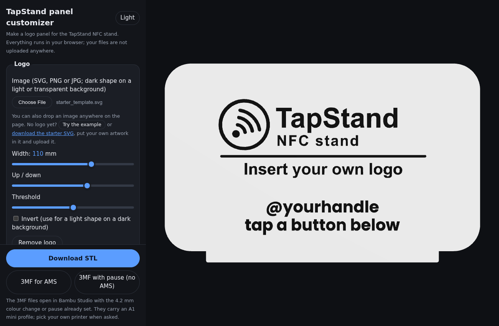
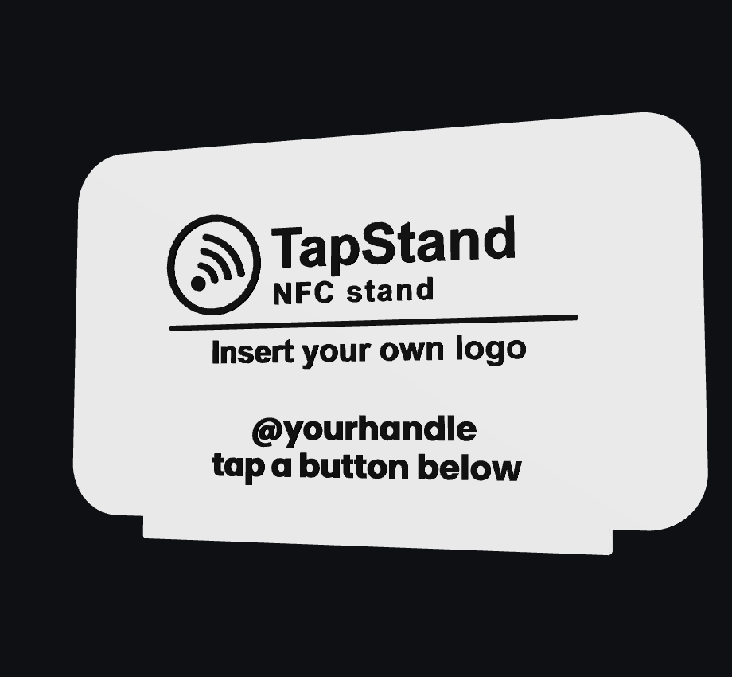

# TapStand panel customizer

Make your own logo panel for the **TapStand NFC stand**, in your browser.

**Open it here: https://dimange.github.io/tapstandnfc/**

## What it does

TapStand is a small 3D-printed counter stand: a logo panel at the back and round tap buttons in
front, each with an NFC tag sealed inside. A customer taps a phone on a button and lands on your
Instagram, your reviews page, your website or anything else with a link.

This page makes the logo panel. You give it a logo and some text; it gives you a file that
fits the stand's base and prints in **two colours on a single-filament printer**, with one pause
and filament swap. No AMS needed, though it works with one too.

## How to use it

1. Open the link above. Nothing to install.
2. Upload a logo, or drop it anywhere on the page (SVG, PNG or JPG; a dark shape on a light or
   transparent background) and, if you like, type some text such as your @handle, on one line or several. No logo
   yet? Press *Try the example*, or download the starter SVG, put your own artwork in it and upload that.
3. Adjust size and position while watching the 3D preview. Details too thin to print are shown in
   red. Pick the body and detail colours to see how your filaments will look; the 3MF files carry
   those two colours.
4. Download the file that suits your printer:

| Download | For | What you do |
|---|---|---|
| **3MF for AMS** | Bambu printers with an AMS | Body colour in slot 1, detail colour in slot 2, slice and print. The colour change at 4.2 mm is already in the file. |
| **3MF with pause (no AMS)** | Bambu printers without an AMS | Start with the body colour. The printer stops at 4.2 mm: swap to the detail colour, purge, resume. |
| **STL** | Any other slicer | 0.20 mm layers, 3 walls, 5 top and 4 bottom layers, 15% infill. Add a pause or colour change at 4.2 mm yourself. |

The 3MF files carry a Bambu Lab A1 mini profile; on another Bambu printer, pick your own printer
when Bambu Studio asks and keep the 0.20 mm layer height. Do not use the AMS file on a printer
without an AMS: it may not stop for the colour change.

## Your files stay with you

Everything runs in your browser. Your logo is not uploaded anywhere, and the page loads nothing
from other sites.

## Good to know

- The panel is 168 × 106 mm and 5.2 mm thick including the raised detail. It needs a bed of at
  least 170 × 110 mm and a 0.4 mm nozzle.
- Simple, high-contrast logos work best. Photos and very detailed images are refused with a
  message, and specks smaller than 0.3 mm are dropped because they cannot print.
- Text in joined or right-to-left scripts (Arabic, Hindi and others) is not shaped correctly; use a
  logo image for those.
- The base and tap buttons that go with the panel are released separately as the TapStand model on
  MakerWorld. A link will be added here once that listing is live.

## For developers

Plain ES modules, no build step.

| File | Purpose |
|---|---|
| `index.html` | The page and the three.js preview |
| `core.js` | Panel geometry, built with the manifold-3d WebAssembly kernel |
| `shapes.js` | Text outlines, image tracing and placement |
| `threemf.js` | Writer for Bambu Studio project files |
| `bambu_settings.json` | Print settings embedded in the 3MF files |
| `test.mjs` | Tests; run with `node test.mjs` (Node 22 or newer) |
| `vendor/` | Third-party libraries and fonts, with their licences |

To run it locally, serve this folder over HTTP (for example `python3 -m http.server`) and open the
address it prints. It does not work when opened as a file.

## Licence

The page's own code is under CC BY-NC 4.0; see `LICENSE.md`. Third-party libraries and fonts keep
their own licences, listed in `vendor/LICENSES.md`.
